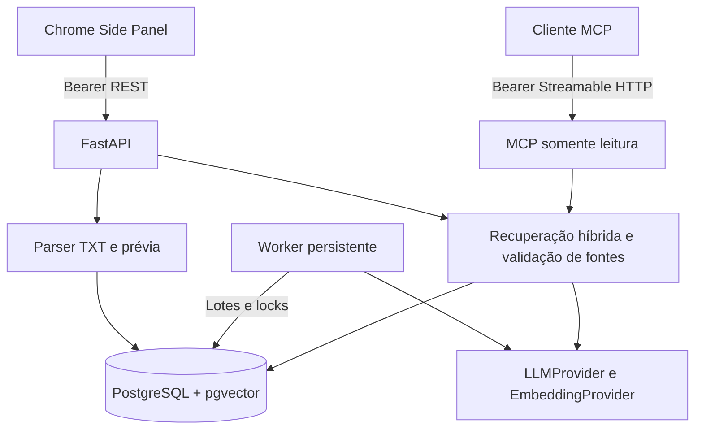

# Arquitetura

A extensão é a interface principal. `apps/extension/src/background` configura
o comportamento da ação; `sidepanel` mantém os fluxos de operação. Não há
content script registrado. `content/context.ts` delimita uma integração futura,
e o estado atual é explicitamente indisponível.

O backend separa parser, persistência, pipeline, recuperação, provedores,
rotas e ferramentas MCP. O pacote `shared-types` valida os contratos consumidos
pelo frontend com Zod. OpenAPI descreve os contratos do backend.

Uma importação é uma transação que grava mensagens e o job pendente juntos.
O worker processa até 20 mensagens e 32 mil caracteres por transação, com
savepoint para todos os artefatos de IA. Falha não reverte mensagens importadas.
A fila usa o PostgreSQL; não há Redis ou Celery.

O banco, e não a conversa mantida pelo LLM, é a memória. Embeddings são índices
derivados. Nenhuma troca de LLM apaga o histórico ou exige reextrair memórias.

O ambiente compartilha um único token entre seus clientes. Não há
isolamento de tenants nem promessa de uma aplicação SaaS. O MCP é montado na
mesma API e reutiliza serviços de recuperação e leitura.

## Extensão v0.2

A v0.2 acrescenta um serviço Node independente com Baileys. Seu outbox criptografado entrega eventos a uma API interna autenticada; mensagens e jobs convergem no mesmo PostgreSQL e worker. Não há um segundo motor. Veja [fluxo, estados e limites](WHATSAPP_CONNECTOR.md).

## Aceite operacional v0.2

A matriz de auditoria, isolamento do ensaio e roteiro humano estão no [checklist de aceite](ACCEPTANCE_CHECKLIST.md). A release não está aprovada enquanto os critérios obrigatórios estiverem pendentes. As migrations publicadas são preservadas; ensaios não usam volumes de dados pessoais.
